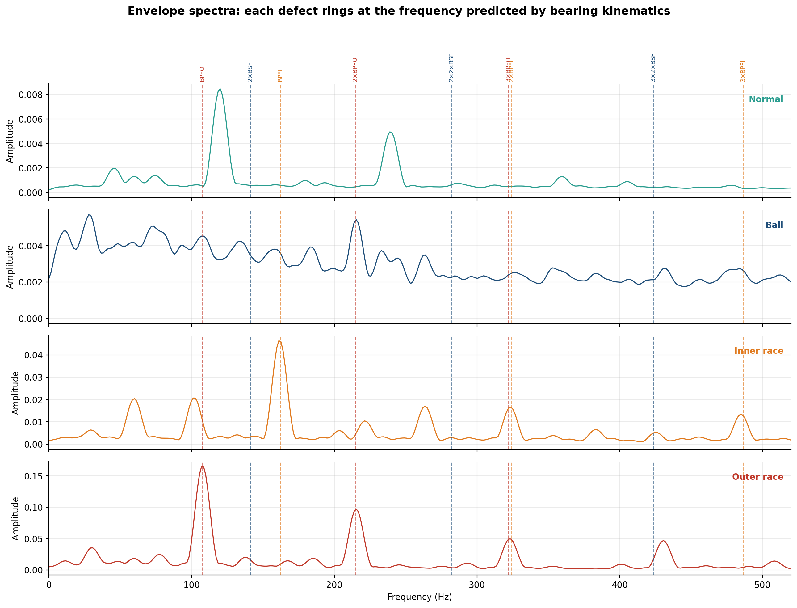
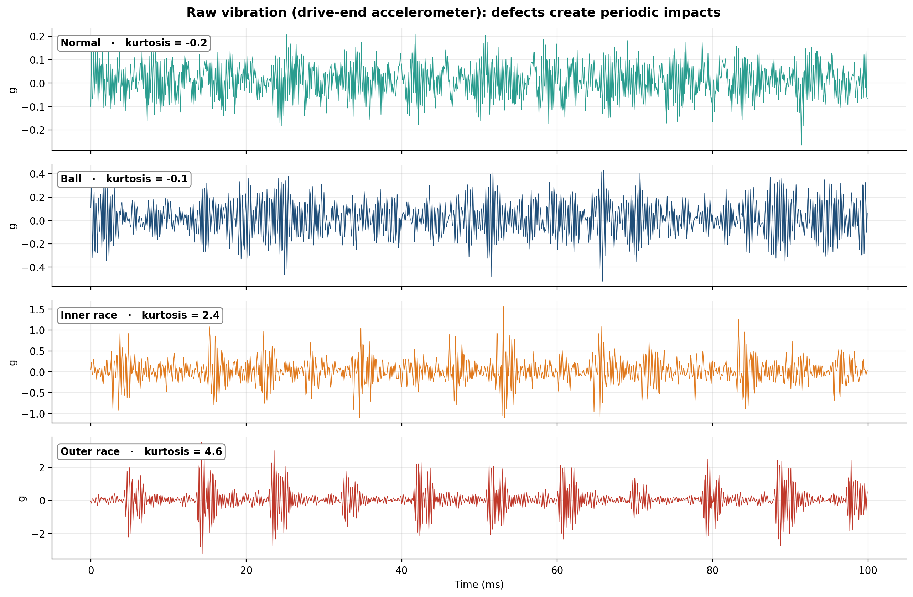
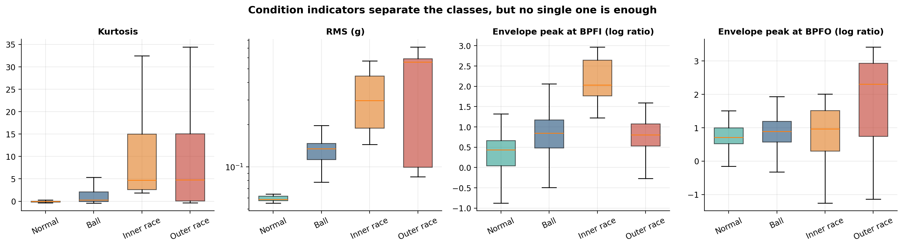
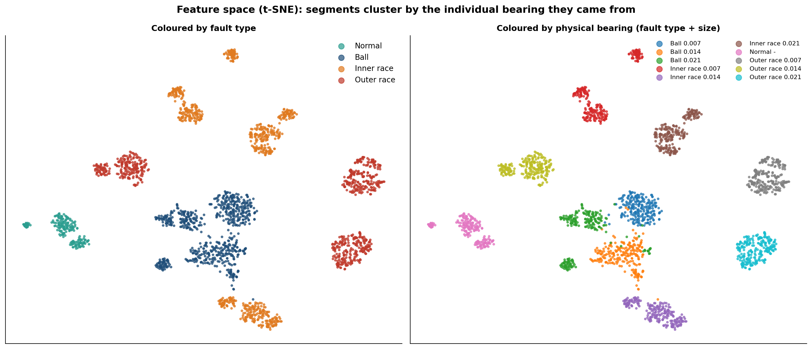
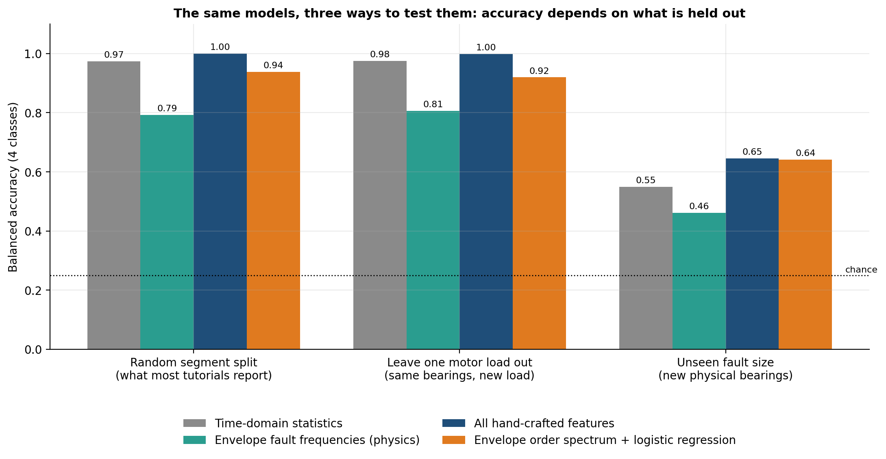
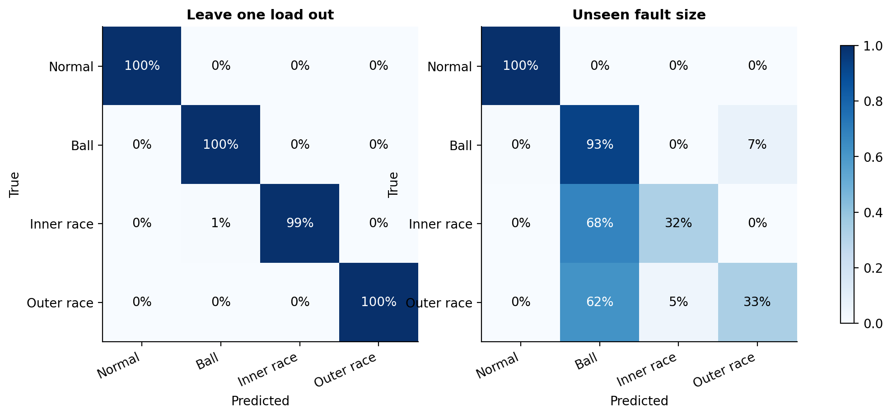
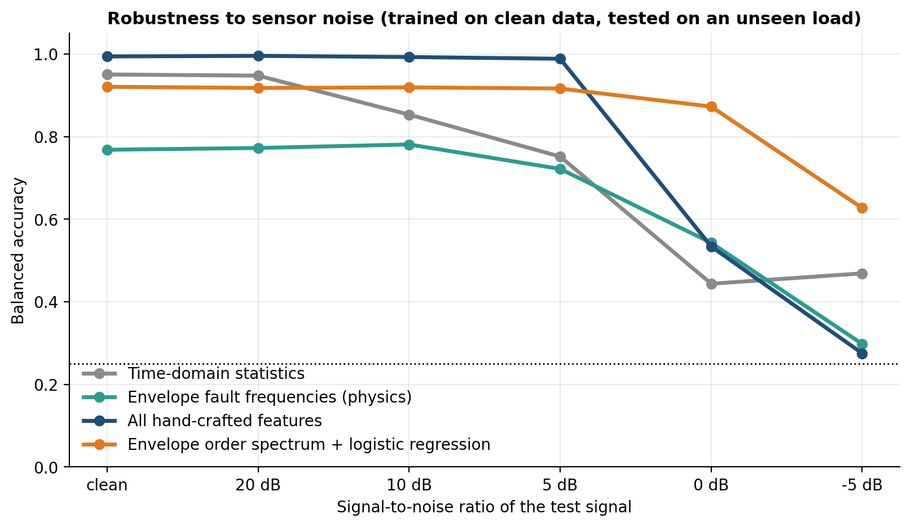
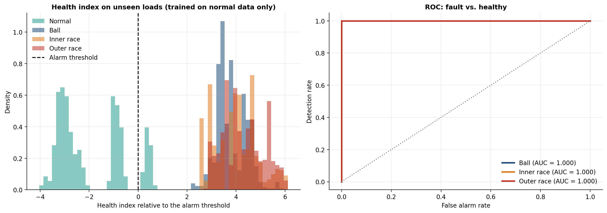
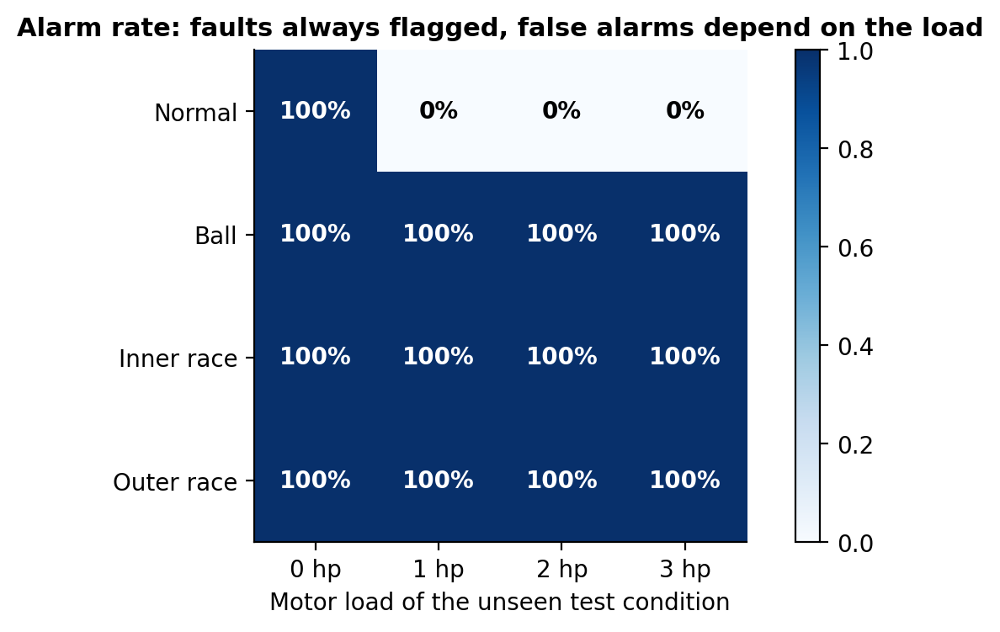
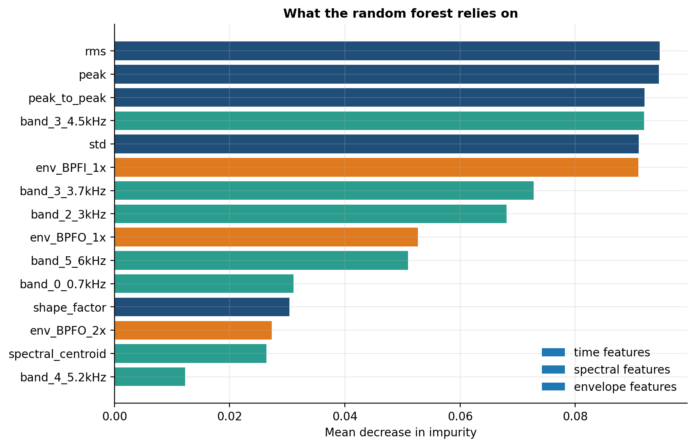

# Bearing Fault Detection and Diagnosis from Vibration

**Vibration Analysis · Signal Processing · Machine Learning · Anomaly Detection**

This project investigates bearing fault detection and classification using vibration signals from the Case Western Reserve University (CWRU) Bearing Data Center. The analysis combines signal processing techniques with machine learning models to distinguish healthy bearings from bearings with ball, inner-race, and outer-race defects.

The study also examines how the evaluation protocol affects classification performance. Models achieve nearly perfect results when vibration segments from the same recordings are randomly distributed between training and test sets. When the evaluation is based on a fault size excluded from training, performance drops considerably.



## Results

Balanced accuracy for the four-class classification task. Random guessing corresponds to a balanced accuracy of 0.25.

| Model | Random segment split | Leave one motor load out | Unseen fault size |
|---|---:|---:|---:|
| Time-domain statistics | 0.97 | 0.98 | 0.55 |
| Envelope fault-frequency features | 0.79 | 0.81 | 0.46 |
| **All hand-crafted features** | **1.00** | **1.00** | **0.65** |
| Envelope order spectrum + logistic regression | 0.94 | 0.92 | 0.64 |

Additional experiments produced the following results:

- **Fault detection:** a Mahalanobis-distance health index trained on healthy data achieved a ROC AUC of 1.00 for distinguishing healthy and faulty segments under the evaluated unseen operating conditions.
- **Noise robustness:** at a signal-to-noise ratio of 0 dB, the envelope order-spectrum model achieved 87% accuracy. The best-performing model on clean data dropped to 53% in the corresponding noisy evaluation.
- **Healthy baseline coverage:** all observed false alarms occurred when the healthy recording at 0 hp was excluded from training. This highlights the importance of representing operating conditions when estimating the normal state.

These results apply to the evaluated CWRU recordings and experimental protocols. They do not establish equivalent performance on naturally degraded bearings or different machines.

## Dataset

The data comes from the [Case Western Reserve University Bearing Data Center](https://engineering.case.edu/bearingdatacenter). The test rig uses an electric motor with seeded defects in the drive-end bearing (SKF 6205), measured with an accelerometer.

| Property | Description |
|---|---|
| Classes | Normal, ball fault, inner-race fault, outer-race fault |
| Fault sizes | 0.007, 0.014, and 0.021 inches |
| Motor loads | 0, 1, 2, and 3 hp |
| Shaft speed | Approximately 1,730–1,797 rpm |
| Recordings | 40, approximately 10 seconds each |
| Segmentation | 2,331 windows of 2,048 samples |
| Sampling rate used | 12 kHz |

The outer-race defects considered here are centered at the 6 o'clock position.

One preprocessing detail is important: the healthy recordings used in the analysis were originally sampled at 48 kHz, whereas the fault recordings were sampled at 12 kHz. The healthy signals are low-pass filtered and decimated to 12 kHz before segmentation. Without this step, sampling-rate differences could become an unintended cue for classification.

## Signal processing and feature extraction

Bearing defects produce repetitive impacts as rolling elements pass over damaged surfaces. These impacts can introduce transient peaks and increase statistics such as kurtosis.



The analysis extracts three groups of features from each segment:

- **Time-domain statistics:** RMS, kurtosis, crest factor, and other measures of signal amplitude and shape.
- **Spectral features:** energy in selected frequency bands.
- **Envelope features:** amplitudes around characteristic bearing fault frequencies and their harmonics.

### Envelope analysis

Envelope analysis is used to identify repetitive impacts that may be difficult to distinguish in the raw vibration spectrum. The signal is band-pass filtered around structural resonances between 2 and 5 kHz. The Hilbert transform is then used to obtain the envelope, whose spectrum is analyzed for characteristic peaks.

For the bearing geometry used in the study, the characteristic frequencies are expressed relative to shaft rotational frequency:

| Fault frequency | Order |
|---|---:|
| Ball pass frequency, inner race (BPFI) | 5.415× |
| Ball pass frequency, outer race (BPFO) | 3.585× |
| Ball spin frequency (BSF) | 2.357× |

These frequencies provide physically motivated features for classification. Their observed values can vary with shaft speed and signal-processing choices.



## Evaluation protocol

The way recordings are divided between training and test sets has a substantial effect on the reported results.

Each recording corresponds to a particular physical bearing under a specific operating condition. Dividing a recording into short segments and randomly assigning those segments to training and test sets allows the model to encounter highly related signals from the same bearing in both subsets.

Holding out a motor load is a more demanding test of operating-condition generalization, but it does not necessarily test generalization to new hardware. The same physical bearing may have been recorded at multiple loads.



The unseen-fault-size protocol holds out a defect size during training and uses it for evaluation. This provides a more demanding test of whether the model can classify bearings with fault sizes absent from its training data.



Under this protocol, the all-feature model achieves a balanced accuracy of 0.65, compared with 1.00 under the random segment split. The confusion matrices show that inner-race and outer-race defects can be confused with ball faults.



This comparison illustrates why evaluation results should be interpreted in light of the data-splitting strategy. High accuracy on segments from familiar recordings does not necessarily imply equivalent performance on previously unseen bearings.

## Robustness to noise

Vibration measurements in industrial environments may contain substantial background noise. To investigate this effect, the models are evaluated with Gaussian noise added to the signals under a held-out motor-load condition.

Features based mainly on signal amplitude are more sensitive to noise. The envelope order-spectrum model retains more of its classification performance at low signal-to-noise ratios by using the distribution of spectral energy around characteristic orders.



## Anomaly detection using healthy data

In many maintenance applications, labeled fault examples are limited. Anomaly detection provides an alternative by modeling normal operating behavior and identifying observations that deviate from it.

The health index in this project is based on the Mahalanobis distance from the healthy feature distribution. Only normal data is used to estimate the reference distribution. The alarm threshold is calibrated using held-out operating conditions to examine how changes in load affect false alarms.



The alarm-rate analysis shows the importance of including representative healthy operating conditions when defining the reference state.



Feature importance provides additional information about which extracted measurements contribute to the classification results.



## Project structure

```text
├── config.py
├── run.py
├── scripts/
│   └── download_data.py
├── src/
│   ├── data.py
│   ├── features.py
│   ├── models.py
│   ├── anomaly.py
│   └── plots.py
├── tests/
│   └── test_core.py
├── figures/
└── results/
```

- `config.py`: sampling rate, window size, envelope frequency band, and bearing geometry.
- `run.py`: executes the analysis.
- `scripts/download_data.py`: downloads the dataset.
- `src/data.py`: recording loading, resampling, and segmentation.
- `src/features.py`: time-domain, spectral, envelope, and order-spectrum features.
- `src/models.py`: classification models.
- `src/anomaly.py`: health index and operating-condition threshold calibration.
- `src/plots.py`: figure generation.
- `tests/test_core.py`: unit tests, including a synthetic impulsive signal with a known fault frequency.
- `figures/`: generated plots.
- `results/`: experiment outputs.

## Installation and execution

Create and activate a virtual environment, then install the dependencies.

```powershell
python -m venv .venv
.venv\Scripts\Activate.ps1
pip install -r requirements.txt
```

The download script retrieves the recordings used by the pipeline. Runtime and download size depend on the dataset version and execution environment.

## Limitations and future work

- The CWRU dataset uses seeded defects produced under controlled conditions. These defects may differ from naturally developing bearing damage.
- The number of healthy recordings is limited, which restricts the coverage of operating conditions available for estimating normal behavior.
- The unseen-fault-size protocol tests generalization to a held-out defect size, but does not by itself establish generalization across different machines, bearing types, or acquisition systems.
- Future work could evaluate 1D convolutional networks under the same evaluation protocol, investigate domain adaptation across machines, and estimate fault severity.
- Evaluation on additional datasets, such as the Paderborn University bearing dataset and NASA IMS bearing data, would help assess how well the approach transfers to other experimental conditions.

## References

- W. A. Smith and R. B. Randall. “Rolling Element Bearing Diagnostics Using the Case Western Reserve University Data: A Benchmark Study.” *Mechanical Systems and Signal Processing*, 2015.
- R. B. Randall and J. Antoni. “Rolling Element Bearing Diagnostics — A Tutorial.” *Mechanical Systems and Signal Processing*, 2011.
- C. Lessmeier et al. “Condition Monitoring of Bearing Damage in Electromechanical Drive Systems by Using Motor Current Signals of Electric Motors: A Benchmark Data Set for Data-Driven Classification.” *PHM Society European Conference*, 2016.

## Author

**Evelyn Natalie Aguiar de Almeida**

Mechanical Engineer · M.Sc. in Computer Science · Ph.D. Student in Computer Science